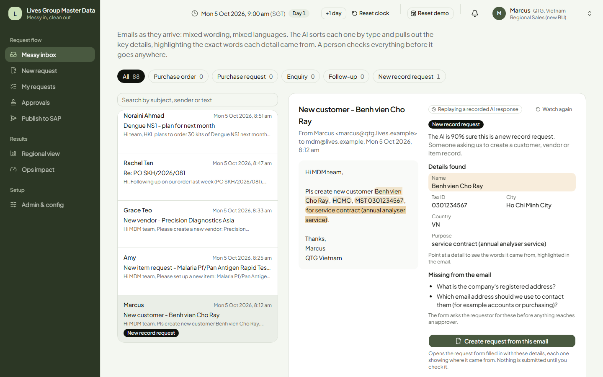
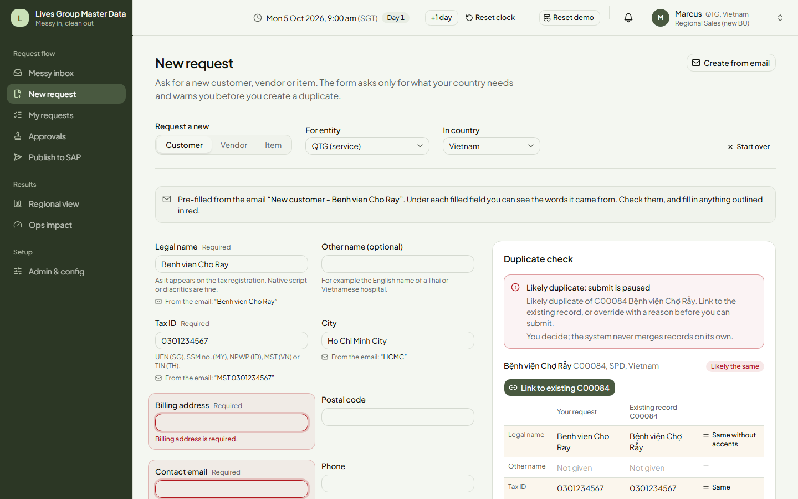
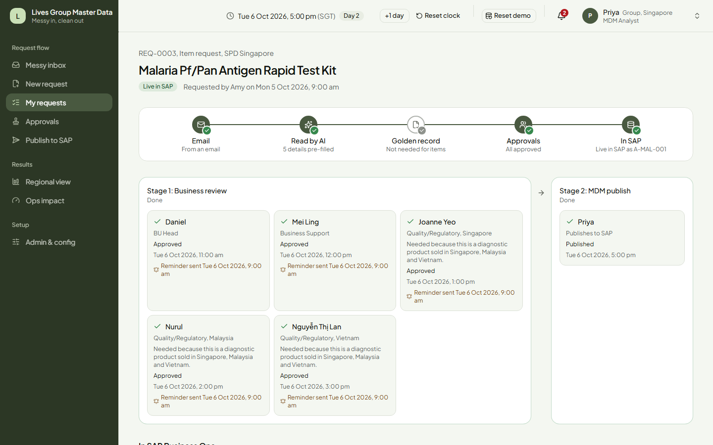
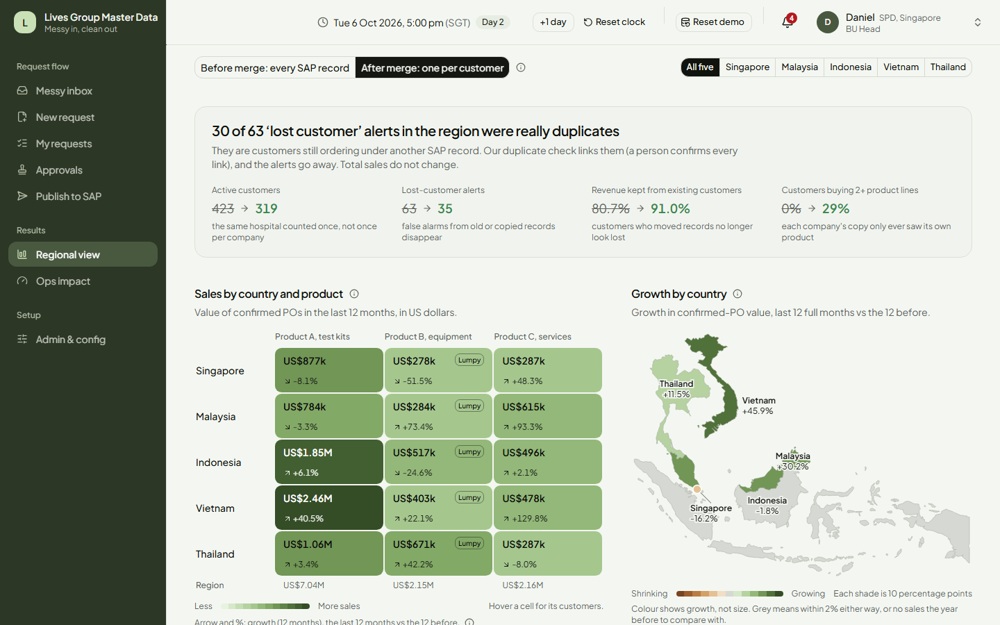
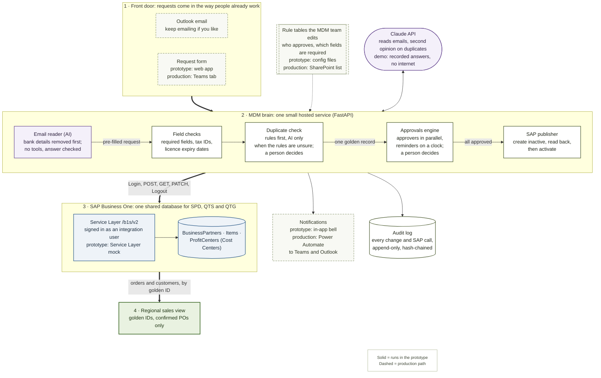
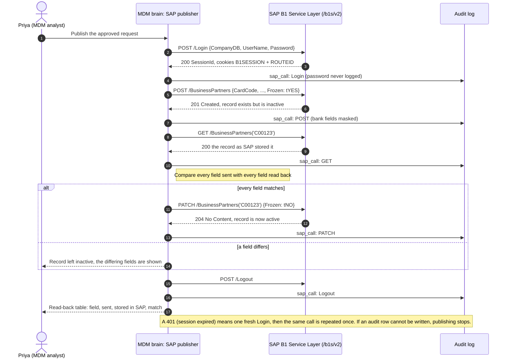

# Messy in, clean out

**A master-data prototype for Lives Group.** SMU DSA Society 2026 Data Case Competition. Built solo by Ihsan Alfian.

**Demo video:** `<YouTube link, added Tue>`

**For judges: start here**

1. Watch the demo video (link above).
2. Read the [Headline results](#headline-results) table.
3. For the method, caveats and every table: [`docs/results.md`](docs/results.md).

Lives Group's three companies (SPD, QTS and QTG) share one SAP Business One system across Singapore, Malaysia, Indonesia, Vietnam and Thailand. Requests for new customers, vendors and products arrive as free-text emails, in five countries' worth of spellings, scripts and languages. This prototype reads those emails where they arrive, checks the request against the records that already exist so each customer gets **one golden record**, sends it to every approver **at the same time**, and publishes it to SAP Business One with a read-back check. Because each customer now has one ID, the same data gives an **honest regional sales view**: real orders only, no customers that look "lost" because they were re-created under a new name.

It runs on a laptop, offline after `make setup`, with synthetic data. No API key is needed for the demo. AI models: Claude Haiku 5.5 reads the emails; Claude Sonnet 5.5 gives a second opinion on duplicates the rules are unsure about (and wrote the 24 unseen test emails). The demo replays their recorded answers.

---

## The problem, in Lives Group's terms

- **Amy's item request took 18 days.** Approvals go one after another by email; each person waits for the one before, and a missing field sends the request back to the start.
- **The same customer exists many times.** "Bệnh viện Chợ Rẫy", "Benh vien Cho Ray" and "Cho Ray Hospital" are one hospital. When SPD, QTS and QTG each set up their own copy, SAP sees three customers. Nobody can tell which record is the real one.
- **The regional view is wrong because of it.** A customer re-created under a new name looks "lost" on the old record and "new" on the new one. Customer counts are inflated, retention looks worse than it is, and nobody can see who buys more than one product line.
- **Enquiries get counted as orders.** Spreadsheet planning mixes enquiries and requests in with confirmed POs, and that distorts equipment planning most.

## What it does, in five steps

1. **Read the messy inbox.** The AI sorts 88 emails (orders, planned orders, enquiries, follow-ups, master-data requests) and copies out each detail **with the exact words it came from**. Values without a matching quote are dropped. Bank details are removed before the AI sees anything.
2. **One golden record.** A new-customer request is checked against existing records as it is typed: tax ID first, then names across languages and scripts (diacritics, Thai script, "RS" = "Rumah Sakit"), then fuzzy matching; the AI only gives a second opinion when the rules are unsure. A human always decides. The duplicate is linked, and never reaches an approver.
3. **Approve in parallel.** A rule table the MDM team owns decides who approves. Everyone in a stage is asked at once; reminders and escalations run on a clock. Incomplete or out-of-date requests (an expired product licence, say) are stopped before any approver sees them.
4. **Publish to SAP Business One.** One click: the record is created inactive, read back, compared field by field, and only then activated. Every call is in the audit log.
5. **See the region honestly.** Before vs after merge: the same sales, fewer and truer customers, false "lost customer" alerts gone, and the products each customer is missing.

## Screenshots

All at 1440x900, from the automated demo rehearsal (`make rehearse`) on the seeded demo data.

| | |
|---|---|
|  |  |
| **The messy inbox.** The AI reads one email, sorts it, points each detail at the words it came from, and lists what is missing. | **Duplicate check.** "Benh vien Cho Ray" is matched to the existing "Bệnh viện Chợ Rẫy" record by tax ID and name. |
|  |  |
| **Status page.** From email to SAP in five steps: every approver, side by side, and the record now live in SAP. | **Regional view.** After merging duplicates: 30 of 63 "lost" alerts were duplicates; sales by country and product, growth by country on the map. |

## Headline results

Every number comes from synthetic data and is regenerated by `make eval`. Full method, caveats and tables: [`docs/results.md`](docs/results.md).

| Result | Number | Honest caption |
|---|---|---|
| "Lost customer" alerts that were really duplicates | **30 of 63** (Vietnam: 7 of 15) | The customer was still ordering under another record. [Details](docs/results.md#regional-view-and-duplicate-damage-prd-m8) |
| Customers in the region | **423 records → 319 customers** | Same revenue in both columns: merging fixes *who* the customer is, not how much was sold. |
| Net revenue retention (last 3 months vs the 3 before) | **80.7% → 91.0%** | Raw records make retention look 10 points worse than it is. |
| Customers buying 2+ product lines (cross-sell) | **0% → 29%** | Before the golden record you cannot see cross-sell at all: each company only sees its own product. |
| Emails sorted correctly, on 24 **unseen** emails | **AI 23 of 24** vs keyword rules 13 of 24 | Written by a different AI from a style brief; labels locked before the reader saw them. On the 88 emails we tuned on: 88 vs 83. Small sample. [Details](docs/results.md#email-interpreter-on-unseen-emails-d-018) |
| Real duplicates blocked outright, unseen data | **97.0%**, and right 99.2% of the time it blocks | Matching on tax ID alone would catch 69.9%. The dictionary was written on our own synthetic data, so expect lower on real SAP data. [Details](docs/results.md#duplicate-check-prd-m4) |
| Request cycle time (median) | **14.7 → 3.5 business days** (Amy's item: 18 → about 4) | **Modelled, not measured:** the new rules replayed on past requests, every assumption labelled. [Details](docs/results.md#request-cycle-time-today-vs-new-process-prd-m10) |
| Forecast vs the Excel 6-month average | **A tie at country level** (15.2% vs 15.4% error) | We do not claim a better forecast. **The biggest error is the data:** counting enquiries as orders takes the equipment plan's error from 28% to 271%. Ours does win on service contracts (29.7% vs 38.9%). [Details](docs/results.md#forecast-backtest-prd-m9) |
| Bank numbers that reached the AI or its saved answers | **0** | Removed before every AI call, by design (rule 5 below). |

## How it connects to SAP Business One

Solid boxes and arrows run in the prototype. Dashed ones are the production path, and each dashed box names its prototype stand-in (legend bottom right). A PNG of this diagram for slides is in [`docs/img/architecture.png`](docs/img/architecture.png).



**Going live does not need a new IT team.** The MDM team edits the rule tables (who approves, which fields are required) themselves. The one piece that needs outside help once is the hosted "MDM brain" service and its SAP connection: point it at the real Service Layer URL and give it an integration user (this needs SAP's indirect-access licence). People keep using Outlook and Teams.

### How a record lands in SAP B1

The publisher never writes a record that goes live unchecked. A PNG for slides: [`docs/img/sap-sequence.png`](docs/img/sap-sequence.png).



Items work the same way (`/Items`, `Frozen`). Cost Centers are `ProfitCenters` in the Service Layer and use `Active` (`tNO` then `tYES`) instead of `Frozen`.

### Safety rules the code enforces

1. A customer record and a vendor record for the same company are **not** duplicates (SAP B1 needs both).
2. The same hospital group in two countries is **not** a duplicate: they are separate legal entities, linked by a group ID.
3. **The AI never approves and never merges.** A person confirms every merge and every approval.
4. The email-reading AI has **no tools**. Its answer is checked against a schema; ordinary code does the routing and publishing. Nothing written in an email can change approvers, bank details or credit terms.
5. **Bank details never go to the AI**, are never logged in plain text, are encrypted at rest, and are masked for everyone except Finance.

---

## How to run

**Requirements:** [uv](https://docs.astral.sh/uv/) (installs Python 3.11+), Node 22, pnpm, and GNU Make. **On Windows:** run everything in **Git Bash**, and install Make with [Scoop](https://scoop.sh/) (`scoop install make`); the Makefile calls Node directly, so pnpm's `.cmd` shims are not needed at run time.

```bash
make setup          # install Python (uv) and Node (pnpm) dependencies; creates .env with an encryption key
make reset-demo     # load the frozen demo data into data/app.db
make dev            # API :8000, SAP B1 mock :8001, web app http://localhost:3000
```

| Command | What it does |
|---|---|
| `make setup` | Install Python (uv) and Node (pnpm) dependencies. Creates `.env` from `.env.example` with a new `FIELD_ENCRYPTION_KEY` (bank fields are encrypted at rest); an existing key is never changed. |
| `make data` | Run the synthetic data generator (seed 42) into `data/generated/`. |
| `make fixtures` | Freeze the demo dataset into `data/fixtures/` and reload the database. |
| `make dev` | Run the API (8000), the SAP B1 mock (8001) and the web app (3000). |
| `make reset-demo` | Restore the seeded demo state (same code as the in-app **Reset demo** button, under 10 s). |
| `make test` | All Python tests, plus web type-check and lint. |
| `make e2e` | Playwright browser tests. Starts its own copies on ports 8101/8100/3100 and stops them. |
| `make rehearse` | Timed walk through the demo storyline, with 1440x900 screenshots in `apps/web/test-results/rehearse/`. |
| `make eval` | Re-run the duplicate, email and forecast evaluations; rewrites `docs/results.md`. |

`make e2e` and `make rehearse` need Playwright's Chromium once: `cd apps/web && pnpm exec playwright install chromium`.

### AI without an API key (replay mode)

`LLM_MODE=replay` is the default. Every AI answer used in the demo was recorded once and is stored in `data/fixtures/llm_cache/`, keyed by `sha256(model + prompt version + input)`, so the demo gives the same result every time, with no internet and no key. The app labels replayed answers ("Replaying a recorded AI response"). If an answer is missing, a keyword fallback runs and the app shows "AI offline". `make record` re-records with a real `ANTHROPIC_API_KEY` (and stops if the estimate is over US$5); `LLM_MODE=live` calls the API directly.

### Where things are

```
apps/web/            Next.js web app: inbox, request form, approvals, status, publish, regional view
services/api/        FastAPI "MDM brain": workflow, duplicate check, interpreter, analytics, audit
services/sap_mock/   SAP B1 Service Layer mock (/b1s/v2)
ds/                  Python: data generator, duplicate check, email interpreter, forecasting, analytics
config/              Rule tables: approvers, required fields, form definitions
data/fixtures/       Frozen demo dataset + recorded AI answers
notebooks/           Evaluation scripts behind docs/results.md
docs/                Product spec, decisions log, data spec, results, demo script
```

Decisions and the reasons behind them: [`docs/decisions.md`](docs/decisions.md). Product spec: [`docs/PRD.md`](docs/PRD.md).

---

## Honest notes

- **All data is synthetic, from a published generator.** No dataset was provided. The generator, its parameters and the ways it makes mess are documented in [`docs/data-spec.md`](docs/data-spec.md); same seed, byte-identical output. One forecast scenario is built so the Excel average should tie or win, and we report it.
- **Real public hospital names, fictional data.** Public hospitals (NUH, Chợ Rẫy, Siriraj, RSCM, Hospital Kuala Lumpur and others) appear by name for realism, as the brief itself does. Every ID, tax number, contact, address, order and amount is invented. Private hospital chains are replaced with invented names.
- **SAP fields to verify against the real system's `$metadata`.** Field names follow the SAP B1 Service Layer (v2) documentation; these are marked `[verify $metadata]` or `[unverified]` until checked on a real system:
  - `Frozen` (`tYES`/`tNO`) as "inactive until approved" on BusinessPartners and Items;
  - the exact v2 error JSON shape, and the error codes the mock returns (duplicate key `-5002`, expired session `301`);
  - user-defined fields `U_MDM_ReqID`, `U_GoldenID`, `U_Entity`, `U_IVD`, `U_RegSummary` must be created in B1 first. Per-country product registrations live in our own database (production: a B1 user-defined table).
- **Regulatory rules:** Singapore (HSA), Vietnam (Decree 98/2021) and Indonesia (AKL/NIE) were researched; the Malaysia and Thailand details are assumptions.
- **Cycle time is modelled, not measured.** It replays the new rules on past requests; assumptions and sources are listed in `docs/results.md`.
- **The AI numbers are optimistic.** The tuned-set scores are on emails from our own templates; the 24 unseen emails are a small sample and still AI-written.

### What we deliberately did not build in v1

| Not built | Why |
|---|---|
| A real SAP B1 connection or Microsoft 365 tenant | No access to Lives Group's systems. The mock speaks the same Service Layer calls, so the swap is a URL and an integration user. |
| Login / single sign-on | A persona switcher stands in; the server still enforces who may do what. Production: Microsoft Entra ID. |
| Automatic merges or AI approvals | By design: a person decides every merge and approval. |
| Splink (probabilistic record linkage) | Evaluated; worth it once real data with more filled-in columns exists. |
| Machine-learning or fine-tuned forecasting models | Simple combined statistical models already tie the Excel average; the gain is in cleaner data, not a bigger model. |
| A full Cost Center screen | Config and the mock endpoint exist; the form is customers, vendors and items first. |

---

## Licence and data sources

- Code: [MIT](LICENSE), Copyright (c) 2026 Ihsan Alfian.
- Map shapes: [Natural Earth](https://www.naturalearthdata.com/) 1:50m admin-0 countries, trimmed to Singapore, Malaysia, Indonesia, Vietnam and Thailand (`apps/web/public/geo/sea-5.geojson`). Public domain.
- All business data: synthetic, generated by `ds/generator/` (see [`docs/data-spec.md`](docs/data-spec.md)).
